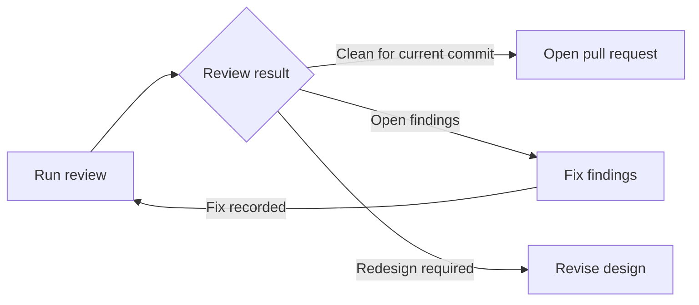

# User-defined lifecycle workflows

A lifecycle is a workflow that people can create, test, publish, assign to work, and improve from evidence. The ZGX Lifecycle tab should edit the same definition that TOD executes. Default ships as an ordinary workflow revision that users can duplicate and edit. Agent protocols, checks, and integrations become reusable actions or data providers that a workflow can arrange.

Today the ZGX tab displays the built-in lifecycle and edits some agent settings. The built-in graph and parts of its runner still contain fixed phase names and review behavior. The new backend will run saved definitions alongside that implementation during migration. [Current lifecycle](../../crates/tod-core/src/lifecycle/flow.rs)

## REQ-LIFECYCLE-01 · Define and assign lifecycles

A user can define multiple lifecycles with nodes, transitions, agents, gates, and rules. The user can assign one to a task or selection and see the current node, what blocks progress, and what will move it forward. The current TOD lifecycle is a starter.

**Acceptance** — Define two workflows with different gates, assign each to a task, and inspect the transition rationale. Preview a rule revision and see which running tasks and prerequisites would be affected before migrating them.

### Authoring in ZGX

| User action | Editor behavior |
|---|---|
| Create, duplicate, or import | Start a draft from an empty canvas, a published revision, or an exported definition. Show validation results and unresolved bindings on import. |
| Add a node | Use **Add node** on the canvas or select an arrow and insert a node. Choose an action, name it, and configure its inputs and outputs in the inspector. |
| Edit a node | Select it to edit its name, action, inputs, output fields, and settings. For an agent action, show its prompt, ordered skills, context, model, and expected result. Moving a box changes its layout. |
| Connect nodes | Select a source and destination or drag a connection. Click the arrow to define its condition. A decision can have several outgoing arrows and one otherwise route. |
| Delete or replace | Preview affected arrows, bindings, and revision migrations. Allow unfinished drafts to retain diagnostics for unresolved references. Support undo while editing. |
| Manage sources | Open **Data sources** to browse the fields a source provides, bind it to this task or an artifact, and preview values on sample work. Show where a binding is used before changing or removing it. |
| Test, publish, assign | Preview the draft using recorded or supplied inputs. Inspect a walkthrough before publishing. Assign a published revision to a task or selection, with preview for an in-flight migration. |

The chart stays visible while the right inspector edits the selected node or arrow. Run view highlights the current visit and shows the last decision, remaining work, and waits. A draft may be saved while incomplete. Publication requires valid references, reachable nodes, configured actions, type-checked gates, and deliberate handling of cycles. Published and historical revisions remain available while referenced.

## REQ-LIFECYCLE-02 · Define gates from typed values

The condition builder starts with clauses such as **Required checks · status · equals · Passed**. It supports nested **All**, **Any**, and **Not** groups, comparisons between compatible fields, and an **Otherwise** transition. Field and operator pickers come from the source schema. The builder explains each clause in plain language and previews its result using a sample.

The stored condition is a tree of typed comparisons, with the field references kept as structured IDs. Renaming a field label requires no rule rewrite. A new field type or operator extends the supported schema. The first operators are equality, inequality, and ordered comparisons for integers. Later versions can add presence tests, enum membership, collection predicates, and durations as real workflows require them. Use explicit conversions if a provider's representation changes.

For example, the **Clean review** arrow can require all of the following.

- **Run review · disposition** equals **Clean**.
- **Run review · reviewed commit** equals **Current change · commit**.
- **Review findings · open count** equals **0**.

The engine evaluates one observation snapshot. A comparison can be true, false, waiting, or failed to evaluate. A missing or stale observation is waiting. A provider failure is reported as an evaluation error and can be retried under the runner's wait policy. A false clause settles an **All** group and a true clause settles an **Any** group even if other clauses are unavailable. **Not** preserves unavailable states. An otherwise route applies after every regular condition is false. When one arrow matches and another can still match because a value is unavailable, hold for the unresolved value. Two matching arrows produce a conflict with the matching rules shown. A later revision may add explicit priority where the author needs it.

**Acceptance** — Build a gate comparing a review's commit to the current commit and requiring zero open findings. Preview a changed commit, a missing review, a provider error, and a clean review. Each preview explains the resulting action or wait.

### Sources, bindings, and observations

| Source | Example binding | Example fields |
|---|---|---|
| Task and related records | Current task and its due obligations | Current commit, unchecked obligation count |
| Node output | Most recent applicable visit to **Run review** in this run | Disposition, reviewed commit, findings |
| Service | GitHub integration and pull requests linked to this task | Required checks, merge state, observed commit |
| Human decision | Approval request created for this visit and revision | Outcome, approver, approved artifact |

A **source** declares a versioned schema and how TOD can obtain and refresh values. A **binding** identifies which task, run, artifact, or service resource supplies them. An **observation** records the value or an explicit unavailable result, when it was read, and a reference to its evidence. A GitHub pass applies to its recorded commit. If the current commit changes, refresh the observation or wait for new evidence. Resolve source permissions through configured integrations and keep credential values out of definitions and traces.

Start with built-in task data, typed action outputs, human decisions, and the GitHub values needed by Default. A user connects and names source instances from the editor. New provider implementations can register schemas independently of the editor. Provider reads belong on the local runner. The first rollout targets devcontainer tasks. A preview can substitute captured or sample observations without invoking integrations or actions.

### Lua as a possible extension

Ship structured conditions first. They cover the expected equality and comparison cases and give users field pickers, validation, and clause-level explanations. Keep the condition format versioned so a future revision can reference a reusable, versioned Lua predicate if real workflows need custom calculations the builder cannot express.

ZGX's ability to host Lua makes a future editor and preview experience plausible. Actual gate evaluation must also work headlessly. If Lua is added, run it behind the same core evaluation interface, over an explicit snapshot of typed inputs. A predicate should return a typed decision and optional explanation. Use a restricted environment with bounded execution and memory, with no ambient file, network, credential, clock, or process access. Fetch data through providers and perform effects through actions. Store the predicate source revision and runtime version with the trace. Keep ordinary rules editable in the visual builder. Evaluate the need for Lua after implementing Default's gates and collecting examples of conditions that are hard to represent.

## REQ-LIFECYCLE-03 · Execute a saved workflow

A definition revision contains an entry node, stable node and route IDs, actions, declared outputs, source bindings, and typed conditions. An assignment pins a task to a published revision. A run records the current node visit and its history. Re-entering a node creates a new visit, including when the edge forms a loop.

The runner starts or resumes the node's action, records its output, evaluates the available transitions, and commits the selected route and new visit. On resume, recheck that events and observations still belong to the applicable visit, inputs, and revision. Use the same decision interface from ZGX, the CLI, the unattended runner, and service wake-ups. Append the transition and update the current visit atomically. Give action dispatch and wake subscriptions durable identities so retries and restarts can resume safely. Ask for a decision or stop visibly when a loop reaches its configured budget or repeatedly makes no progress.

### Review and fix in Default

**Run review** and **Fix findings** are independent executable nodes. The review node reports evidence for the commit it reviewed. The fix node reports what it changed and sends the run back through review. Redesign and review branches use exclusive conditions or a separate decision. Existing review, fix, and escalation routines can supply actions or calculated values during migration. The general runner follows declared connections and has no review-specific routing.

Port the rest of Default by expressing its current phase entry, certification, waits, return destinations, and evidence invalidation using the same definitions. Preserve existing user and integration authority, including separate review or approval where Default requires it. Map old state IDs to Default node IDs and keep old history readable. Compare both implementations against real fixtures before switching existing tasks, including inherited settings, check commands, failed verification, review and PR feedback, and release work.

**Acceptance** — A user builds and publishes the review/fix graph, runs sample work through two visits to review, and sees which evidence allowed it to exit. Reuse the same runner with different node names and actions. Restart during a wait and confirm an older completion cannot advance the new visit.

## REQ-LIFECYCLE-04 · Improve each workflow component from evidence

Treat workflows, actions, prompts, skills, context definitions, and gate policies as versioned improvement targets. Every executable visit records the definition and effective asset revisions, input and output evidence, gate observations and decisions, retries, human intervention, wait time, action time, and agent cost. Context records should identify what was actually selected and supplied, subject to existing access and retention settings. Preserve asset and evidence references when a run has to omit sensitive payloads.

Provide **Improve this** on a run, visit, node, gate, source, or reusable asset. Seed the lesson with the selected evidence and let users record what they expected and what happened. A process review can group these lessons, propose a revision in a draft, and attach a reason and the affected workflows. Keep the proposal linked through review, publication, and measurement.

Run two kinds of comparison. **Replay** evaluates a candidate rule over recorded observations and reports changed decisions, unknown inputs, and skipped visits. **Trial runs** compare prompt, skill, context, or action changes that require fresh execution. Record cohort membership, time range, concurrent changes, and effective revisions. Start with rework, review rounds, human interruptions, wait time, cost, verification failures, and throughput. Apply this process to the improvement workflow itself. [Lessons, analysis, and measures](self-improvement.md)

**Acceptance** — Open a review visit whose result forced rework, make a linked proposal to revise its prompt or skill, and run a comparison against the original revision. An unchanged trace can be reopened and explained after the candidate is published.

## Implementation sequence

1. Add a serializable definition, validation, typed observations, and an inspectable transition evaluator. Exercise the review/fix loop as a graph of independent nodes.
2. Persist drafts and immutable published revisions. Add ZGX create, connect, edit, delete, and validate flows against the same definition. Add source bindings and recorded-input preview.
3. Add durable assignments, visits, action dispatch, waits, and evidence. Run a saved workflow end to end with reusable actions. Attach lessons and revision comparisons to captured visits.
4. Port and verify Default against legacy behavior. Add explicit migration previews and activate the saved Default through the normal runner.

## Implemented in ZGX

**Workflows** opens the flowchart editor. Start with an empty draft, duplicate or import a graph, or choose the Review and Fix example or the operator-driven Default phases. The Default template follows the existing phase order and shows verification rework, review and fix, and redesign as separate routes. Operators report outcomes for manual phases. The graph uses the legacy requirement and plan checks and the workspace readiness rules. The review gate reads the actual task checkout. The merge and release gates use linked pull requests and the repository's release policy. Existing lifecycle automation continues to serve existing tasks while each legacy action and gate is evaluated for migration.

Gate authors can compose typed rules against step output, task records, linked GitHub pull requests, and operator observations. Save and publish work against immutable revisions. The task run view shows live progress, evidence, revision totals, and trace replay against the current draft. It records lessons against a specific node, evaluated route, source field, or pinned agent prompt, skill, or context. A migration preview identifies the source and target revisions and the new entry node. Applying it starts a new run and preserves the source history.

An agent action revision can also specify ordered **Runtime context sources**. The runner evaluates them against the action's task, effective workspace, and earlier workflow visits. The resulting launch context is saved in the conversation and linked to the visit. **View recorded context** and the CLI workflow `context` command show that saved input. New launches resolve context from the current task, its inherited records, and applicable earlier visits.

**Try automated Default** opens a separate candidate. Its task phase mappings let existing task protocols share phase stays and certificates with the graph. Native actions reuse certification, implementation, verification, review, repair, and pull request protocols. Review and Fix have separate visits. The graph captures the checkout before review and compares it with the current checkout at the decision. Merge and release waits are recorded with the visit that owns them and restored by the scheduler after restart. The run links the transcripts used by the native actions.

Each mapped phase can name an adoption point. From **Task workflow run**, preview adoption to see where an existing task will enter the graph and which task stay will be preserved. Returning to the legacy runner preserves that stay and keeps the graph's visits in history. An operator who sends an attached task back enters the published adoption point for that phase. The run records that move with its reason and retains prior visit evidence.

Publishing workflow revisions, versioning agent action bundles, and preserving run evidence provide the basis for improvement experiments. Automated trial cohorts, independently managed skill and context assets, and a general service-provider registry are future work. Lua remains an extension option.

The [Default parity matrix](lifecycle-parity.md) specifies the automated behavior still required for cutover and the evidence each comparative run must record.
